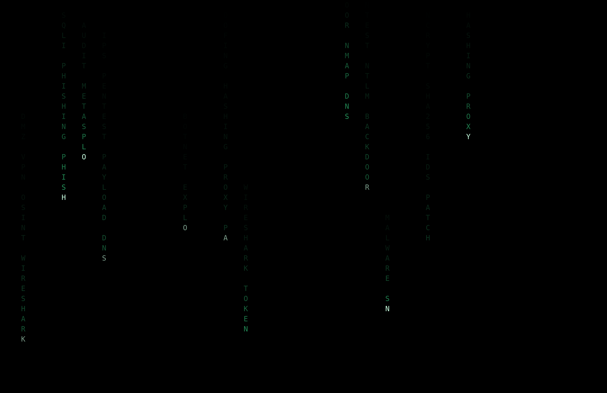

# Cybersecurity Portfolio

A collection of cybersecurity write-ups and content created to demonstrate knowledge and understanding of tasks and exercises, built during my Certificate IV in Cyber Security at TAFE Queensland.

## Projects

- [**Incident Response Exercise**](incident-response-redblue/) — a full attack chain against an isolated lab network, run and documented from both the attacker's side and the defender's side.
  - [Red team: attack chain](incident-response-redblue/red-team.md)
  - [Blue team: detection and response](incident-response-redblue/blue-team.md)

## Small projects

- [**Phishing Response Poster**](small-projects/phishing-response-poster.png) — a quick-reference poster on recognising and responding to phishing emails, recreated from an original flowchart I built in draw.io for a TAFE assessment.

More to come as the cert progresses.
