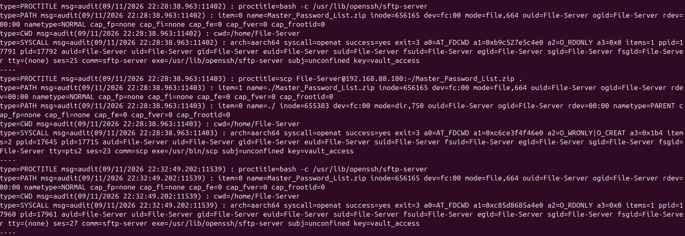
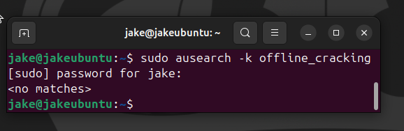

# Incident Response Exercise: Blue Team Detection and Response

The detection and response side of the attack chain in `red-team.md`, same lab exercise, same network. Structured on the NIST SP 800-61 incident handling model: Preparation, Detection and Analysis, Containment/Eradication/Recovery, Post-Incident Activity.

## Objective

Detect and respond to the red team attack chain using host-based auditing, then work out what a real organisation would actually need to change to stop it happening again.

## Tools and environment

- Linux auditd (host-based audit logging)
- ausearch / aureport (log querying and reporting)
- NIST SP 800-61 incident response framework

## 1. Preparation

Before the attack ran, I set up auditd on the target systems with custom watch rules on the stuff that mattered for this scenario: the employee's notes file, the password archive on the file server, the sensitive company-data folder, and the admin's desktop. SSH login auditing came for free through auditd's PAM integration, no extra config needed there.

One gap I only noticed afterwards: there was no email security filtering in place, so the phishing email itself left zero trace in the logs.

## 2. Detection and analysis

The earliest stages of the attack, the OSINT and the phishing email, left nothing on the target network at all. They happened outside anything the organisation was actually monitoring. Detection only becomes possible once the attacker starts touching the network directly.

From that point on, auditd caught clear evidence at every stage, correlated by timestamp:

- **SSH lateral movement.** PAM-integrated logging caught every login. The first lateral-movement login stood out straight away, external IP, outside normal office hours.

- **File access.** The watch rule on the employee's notes file picked up a read event within a minute of that login, probably the attacker digging around for more creds.
- **Further lateral movement and exfiltration.** Same auth logging caught a second SSH login to the file server a few minutes later, and the watch rule on the password archive caught it being read and then copied off.

- **Privilege escalation.** A login to the admin account, same external IP, showed up roughly 15 minutes after initial access. A second login a few days afterward, so they came back later to finish the job rather than doing it all in one go.
- **Impact.** The watch rule on the admin's desktop flagged the file being zipped, the original being deleted, and a new file (the ransom note) appearing, all inside an 8-minute window.

The offline cracking step itself never shows up anywhere in these logs, it happened entirely on the attacker's own machine, outside anything I could monitor.

**Timeline, pieced together from the logs:**

| Order | Event | Timing |
|---|---|---|
| 1 | SSH login to employee account | External IP, outside normal office hours |
| 2 | Notes file read | Within ~1 minute of the login |
| 3 | SSH login to file server | A few minutes later |
| 4 | Password archive read and copied | Same session |
| 5 | Admin account login | ~15 minutes after initial access, same external IP |
| 6 | Second admin login | A few days later |
| 7 | File zipped, original deleted, ransom note created | All within an 8-minute window |

## 3. Containment, eradication and recovery

What I'd actually do, in order:
- Disable the compromised low-privilege account and force a password reset
- Revoke SSH keys across every account involved, force a reset on the admin account
- Rotate every credential exposed in the leaked archive, not just the two that got used
- Cut the file server's exposure down to only the staff who actually need it
- Isolate the admin account for investigation, restore the destroyed file from backup
- Preserve and export the audit logs before touching anything, in case this needs to go further

## 4. Post-incident activity

Root cause for the whole chain was password reuse, the same weak, guessable pattern built from personal details showed up across multiple accounts, including the most privileged one. What would actually close this off:
- An enforced password policy, length, mixed case, no common phrases
- Email filtering to catch the phishing attempt in the first place
- Wider auditd coverage across the network, not just the handful of files in scope here
- Security awareness training around phishing and credential handling
- MFA, especially on SSH accounts

## Findings

Auditd did the job for an exercise this size, but it's a per-host tool, every query has to run against each machine on its own. That doesn't scale. A SIEM like Splunk solves it by pulling logs from every host into one place, so you get cross-system correlation and automated alerting instead of someone manually querying box after box.

## Reflection

Picking this up right after finishing the red side answered the question I was left with: how would you even catch the phishing stage? Short answer, you wouldn't, not with host-based logging alone. The OSINT and the phishing email are pure social engineering, nothing touches a monitored system until the victim's already clicked, so no watch rule or auth log is ever going to see it coming. Once the attacker's on the network though, auditd picked up every single step cleanly.

The other thing that stuck with me: every one of these detections came from me manually running ausearch against one box. In a real environment with more than a handful of hosts, I'd have missed half of this just from not knowing which machine to query first, which is exactly the gap a SIEM is built to close.
